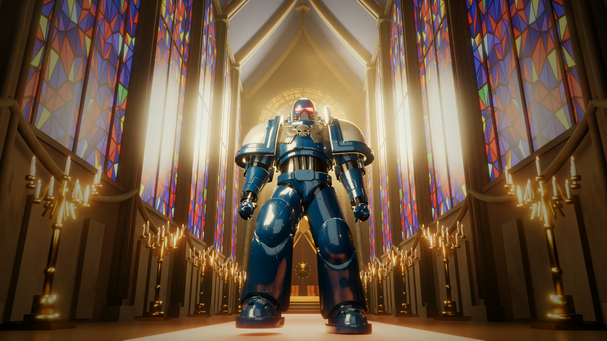

# Astartes · Imperial Angel

> 一个 **30 秒 / 1080p / 24fps** 的纯程序化短片：星际战士在哥特教堂中殿朝镜头走来，镜头与他同速后退，玫瑰窗在背后压出一圈光背。
>
> **除角色网格外，教堂、王座、玻璃、红毯、织花、光柱、骨骼、动作、配乐全部由代码生成**，没有任何外部贴图、HDRI 或商业音乐。角色网格为 CC-BY-4.0 第三方素材，已随仓库分发并完整署名。



**EN** — A 30-second, fully procedural cinematic: a Space Marine walks down a Gothic nave toward the camera while the camera retreats at the same speed. Everything except the character mesh (CC-BY-4.0, credited below) is generated in code: cathedral geometry, stained glass, throne, carpet, brocade, volumetric fog, fake god-rays, rig, IK gait, and a synthesized soundtrack. No external textures, HDRIs, or licensed music. Built with Blender 4.5 (EEVEE Next) + Python/numpy/scipy + ffmpeg.

```bash
BLENDER=/path/to/blender PYTHON=/path/to/python bash build.sh
```


---

## 规格

| 项 | 值 |
|---|---|
| 分辨率 / 帧率 | 1920×1080 / 24 fps / 720 帧 |
| 时长 | 30.000 s |
| 编码 | H.264 CRF16 / yuv420p / bt709 / tv range + AAC 192k 48 kHz |
| 响度 | −14 LUFS（EBU R128 实测 −13.9） |
| 渲染器 | Blender 4.5.15 LTS · EEVEE Next · 28 samples |
| 单帧耗时 | 7–15 s（RTX 3060）／全片 1.5–3 h |

---

## 仓库内容

| 文件 | 作用 |
|---|---|
| `lux_scene.py` | **主场景**：教堂几何、玫瑰窗、肋拱、烛台、王座、雾、光柱、灯光、相机、步态、渲染、后期合成 |
| `build_hero4.py` | 导入 GLB → 合并网格 → 建 13 根骨骼 → 逐顶点权重 → A 字站姿 → `hero4.blend` |
| `build_hero9.py` | 握拳（含拇指收拢）+ 裆部中缝改绑 → `hero9.blend` |
| `build_hero20.py` | 加膝骨 `poleyn_L/R`（取小腿屈曲的 20%）→ `hero20.blend` |
| `build_hero22.py` | 内侧大腿解冻（中缝留 hips，向外渐变回同侧 thigh）→ `hero22.blend` |
| `gen_glass_tex.py` | 三角拼接彩窗 + 玫瑰窗花瓣（极坐标 Voronoi + 石制窗棂） |
| `gen_carpet.py` | 红毯（绒面 + 金边菱格） |
| `gen_brocade.py` | 王座织花丝绒 |
| `make_score30.py` | 配乐合成：管风琴持续音 + 重甲脚步 + 卷积混响 |
| `tile_audio.py` | 把 10 s 循环段拼成 30 s，脚步锁 1.25 s 网格 |
| `build_audio.sh` | 配乐链（合成 → atempo 重定时 → 拼接 + 自检） |
| `verify_model.py` | 校验仓库内模型的 SHA256 与面数 |
| `build.sh` | 端到端构建 |
| `tex/` | 预生成贴图（也可由 `gen_*.py` 重新生成） |
| `out/hald_grade.png` | 调色用 HALD CLUT |

**不入库**（体积或授权原因）：

| 项 | 原因 |
|---|---|
| — | 模型已入库（`model/SM_tex270k.glb`，12.8 MB，CC-BY-4.0） |
| `*.blend` | 每个 41 MB，可完全由 `build_hero*.py` 重建 |
| `out/frames/*.png` | 720 帧共 ≈1.9 GB |
| 成片 `*.mp4` | 请见 Releases |

---

## 依赖

| 工具 | 版本（实测） |
|---|---|
| Blender | **4.5.15 LTS**（EEVEE Next） |
| Python | 3.13 + numpy 2.5 + scipy 1.18 |
| ffmpeg | 8.x（需 `haldclut` / `atempo` / `alimiter`） |
| ImageMagick | 可选，仅用于裁切与分析 |

---

## 构建

```bash
git clone <this repo> && cd astartes-imperial-angel

# 可选：指定 Blender 与 Python
export BLENDER=/path/to/blender
export PYTHON=/path/to/python      # 需装 numpy + scipy

bash build.sh
# → out/astartes-imperial-angel-1080p.mp4
```

只要成片不要整条管线时，可以只跑其中一段：

```bash
# 只渲染关键帧
$BLENDER -b -P lux_scene.py -- --anim 1 --secs 30 --fps 24 \
  --engine EEVEE --csamples 48 --outdir out/kf --fstart 1 --fend 1

# 只重做配乐
bash build_audio.sh
```

---

## 管线要点

### 1. 骨骼与权重

模型是 3D 打印式的分件雕塑，**702 个独立壳体**，没有可用骨架。

- 13 根骨骼：`root / hips / spine / chest / head / uparm·forearm ×2 / thigh·shin·foot ×2 / poleyn ×2`
- 权重不是自动绑定：逐壳体判定主导骨，跨关节壳体在 **0.20 m 关节带**内做线性过渡
- 膝甲单独一根骨 `poleyn`，只取小腿屈曲的 **20%** —— 真实甲片在膝盖处只转一半，取 100% 会把甲片甩出腿面

### 2. 步态（IK 而非正弦摆腿）

先定义**脚在世界上的落点**，再反解膝与髋：

```
支撑期：脚相对髋匀速后移，位移量 = 身体前进量 → 脚在世界坐标里静止
摆动期：三次 Hermite，两端斜率 = 支撑期速度（交接瞬间速度连续）
髋高  ：由腿可达性反推 + 光滑余弦，不用 min() 分支（分支切换会造成每步顿一下）
```

实测量化：

| 指标 | 结果 |
|---|---|
| 支撑脚世界 Y 漂移 | 2.53 mm / 60 帧 |
| 支撑脚 Z 变化 | 0.00 mm |
| 循环首末（骨骼矩阵） | `max|dMatrix| = 0.000e+00` |
| 步态周期 | 2.5 s = 60 帧整（720 帧 = 12 个完整循环） |

### 3. 大气与光柱

丁达尔光试过两条路，结论写在代码注释里：

- **纯体积散射**：雾浓度 0.0026 时 30 m 行程只散掉 7%，不出柱；浓到 0.0105 能出柱但整条中厅糊成灰白，玫瑰窗同时被糊掉。
- **几何光刃**（本片采用）：每束 = 3 片 60° 交叉薄片，横向中间实两侧渐隐、纵向入窗淡入落地衰减，叠一层噪波打散，发光强度 0.46，7 道避开中轴。

另有一个关键坑：**雾必须做成体积盒（y −2→62），不能用世界雾**。世界雾会在玫瑰窗前形成一层均匀亮膜，把窗格细节压掉 65%（实测 σ 0.134 → 0.047）；改体积盒后 σ 回到 0.099。

### 4. 配乐与音画同步

- 配乐为程序合成（管风琴持续音 + 金属共振脚步 + 卷积混响），无第三方音乐
- 原始素材步距 1.54 s，与本片步态 1.25 s 不符 → `atempo=1.232` 重定时，取**整整 8 步**（12.32 s → 10.0 s）保证循环无缝
- 3 份循环 + 40 ms 等功率交叉淡化，接缝落在同相位脚步上，不会双击

| 指标 | 结果 |
|---|---|
| 脚步冲击次数 | 24 次（30 s ÷ 1.25 s） |
| 对 1.25 s 网格的最大偏差 | 24 ms |
| 平均间隔 | 1.2501 s |

---

## 已知限制

1. 模型是扫描件，甲片叠压、铆钉、战损全靠 10 张 PBR 贴图画，几何本身没有这些层次。
2. 膝甲是独立圆弧板，弯到极限时边缘与胫甲之间会张开一道缝——原始资产就是这样，骨骼层面无法闭合。
3. 单机位、单一事件，没有分镜与第二信息。
4. EEVEE 光栅渲染没有真实焦散与多次反弹；要用 Cycles 会慢约 30 倍（170 采样 200 s/帧）。

---

## 授权

| 部分 | 作者 | 许可 |
|---|---|---|
| 角色网格 + 10 张 PBR 贴图 | **Janovich** — [Space Marine](https://sketchfab.com/3d-models/space-marine-650166abbb3448e9adece85e30b59c06) | **CC-BY-4.0** |
| 骨骼 / 权重 / 动作 / 场景 / 贴图 / 灯光 / 配乐 / 脚本 | 本项目 | MIT（代码）· CC-BY-4.0（影像） |

完整署名与第三方声明见 [`docs/THIRD-PARTY.md`](docs/THIRD-PARTY.md)。

> ⚠️ **关于商用**：CC-BY-4.0 只覆盖 Janovich 对这份网格的权利。星际战士 / 动力甲 / 帝国鹰徽的造型属于 **Games Workshop** 的《战锤 40,000》知识产权，这是 CC 许可无法豁免的另一层限制。个人与非商业发布通常无碍；商业化（广告、接活、付费分发）前请自行评估。
